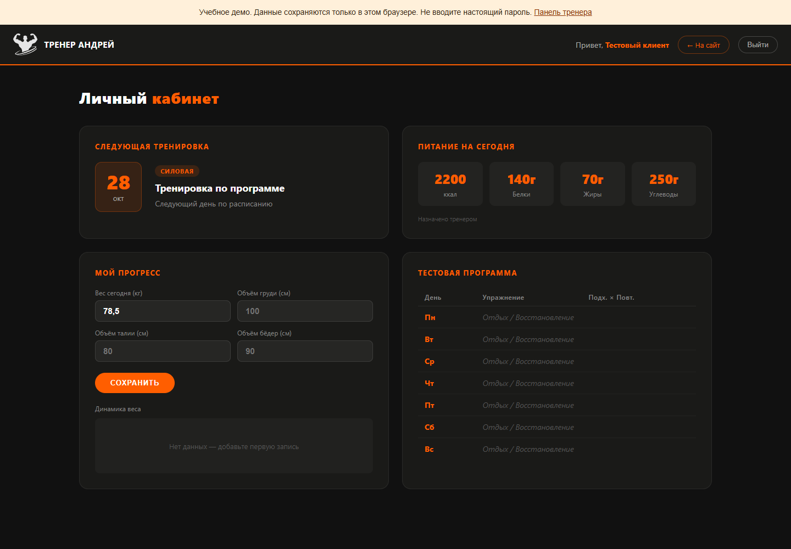

# Сайт фитнес-тренера

Адаптивный сайт персонального тренера Андрея Шарипкулова. Программы тренировок, информация о тренере, результаты клиентов и форма заявки.

[Открыть сайт](https://valkohappy.github.io/sharipculov/) · [Демо личного кабинета](https://valkohappy.github.io/sharipculov/demo/)

## Демо кабинета

В папке demo находится учебная версия с регистрацией, журналом тренировок, замерами, программами тренировок и питания, панелью тренера. Она использует IndexedDB и хранит данные только в текущем браузере. Заявки никуда не отправляются, между устройствами данные не синхронизируются. В панели тренера можно просматривать и менять локальные записи.

Вход и пароли здесь показывают пользовательский сценарий. Это не серверная авторизация, роли не защищают данные от владельца браузера. Для проверки создайте вымышленного пользователя с отдельным тестовым паролем.

## Структура

- Корневые index.html, style.css, img и fonts содержат основную версию сайта.
- demo/js/db.js отвечает за IndexedDB и операции с данными.
- demo/js содержит обработчики отдельных страниц, demo/css содержит стили.
- demo/admin.html содержит демонстрационную панель тренера.

## Локальный запуск

Из папки проекта выполните команду `python -m http.server 8080`, затем откройте http://localhost:8080 или http://localhost:8080/demo/. Используйте localhost или HTTPS, чтобы браузер предоставлял Web Crypto.

Технологии: HTML, CSS, JavaScript, IndexedDB, Web Crypto. Для рабочей многопользовательской версии кабинета требуется сервер с авторизацией и хранением данных.
